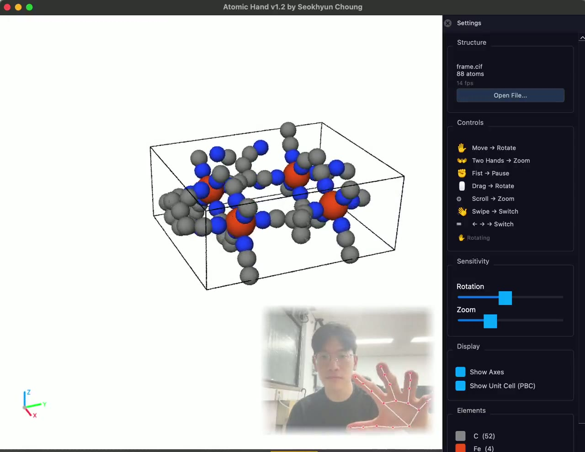

# Atomic Hand

> Rotate, zoom, and flip through 3D molecules with your bare hands — no mouse, no keyboard. Just a webcam.

**Atomic Hand** is a hand-gesture molecular viewer for macOS. It pairs [MediaPipe](https://developers.google.com/mediapipe) hand tracking with [OVITO](https://www.ovito.org/)'s Tachyon ray tracer, so you can manipulate atomic structures in real time using only gestures in front of your laptop camera.



**Landing page & demo videos:** [atomic-hand.schoung.com](https://atomic-hand.schoung.com)

## Demos

| | |
|---|---|
| **Inspiration → reality** — Minority Report (left) and Atomic Hand controlling molecules by hand (right), side by side | [`docs/media/combined_demo.mp4`](docs/media/combined_demo.mp4) |
| **Atomic Hand in action** — rotating and switching molecules by hand | [`docs/media/AtomicHand_demo_compressed.mp4`](docs/media/AtomicHand_demo_compressed.mp4) |
| **Minority-Report-style hologram** — the inspiration | [`docs/media/minority_report_hologram.mp4`](docs/media/minority_report_hologram.mp4) |

The combined clip plays on the [landing page](https://atomic-hand.schoung.com).

---

## Features

- **Real-time hand tracking** — control the camera with open-hand, fist, and two-hand gestures
- **High-quality rendering** — OVITO Tachyon CPU ray tracing with ambient occlusion on idle
- **Multiple render styles** — ball & stick, space filling, wireframe
- **Auto bond detection** — van der Waals based bond generation
- **Mouse + keyboard fallback** — drag to rotate, scroll to zoom, arrows to switch
- **HQ export** — one gesture renders a 1920×1440 PNG to your Desktop

## Gestures

| Gesture | Action |
|---|---|
| Open hand + move | Rotate |
| Wrist twist | Rotate (azimuth) |
| Two hands spread / pinch | Zoom in / out |
| Fist | Pause |
| Fist + swipe L/R | Switch structure |
| Mouse drag | Rotate |
| Mouse scroll | Zoom |
| Arrow keys (left / right) | Switch structure |
| `S` key | Toggle settings panel |

## Install

> **⚡ Using Claude Code or Codex?** Just give it this prompt in a terminal: **`"clone the repo, set up the environment, install everything, and launch the demo"`** and it takes care of the rest. Skip the manual steps below.

**Prerequisites:** macOS with `git` and `conda` installed.

- No `conda`? Install [Miniconda](https://docs.conda.io/projects/miniconda/en/latest/).
- No `git`? Run `xcode-select --install`.

Tested with Python 3.11 (conda).

```bash
git clone https://github.com/s-choung/atomic-hand.git
cd atomic-hand

# create environment
conda create -n atomic-hand python=3.11
conda activate atomic-hand

pip install ovito mediapipe==0.10.14 opencv-python PySide6 numpy
```

> **Note:** OVITO bundles its own PySide6. If you hit a Qt conflict, install `ovito` first and let it pull its dependencies.

## Run

```bash
# launch with the bundled demo molecules
python src/app_window.py structures/*.xyz

# or a specific structure
python src/app_window.py structures/C60.xyz
```

Grant camera permission when macOS asks. Hold an open hand in front of the camera and move it to rotate.

## Architecture

```
CameraReaderThread  -> grab frames at max speed, drain buffer
MediaPipeThread     -> latest frame -> MediaPipe -> gesture engine
MainThread          -> QTimer 16 ms: consume gesture, Tachyon render, overlay
```

- **`src/app_window.py`** — main app (PySide6 + threaded camera)
- **`src/gesture_engine_v2.py`** — gesture classification (rotate, zoom, swipe, wrist twist)
- **`src/molecule_renderer.py`** — OVITO Tachyon wrapper (camera, styles, bonds)
- **`structures/`** — demo molecules (C60, ethanol, pyrrole, water, …)

## Demo molecules

`C60`, `C60_buckyball`, `ethanol`, `ethane`, `acetaldehyde`, `glyoxal`, `formic_acid`, `pyrrole`, `water` — all in `structures/` as `.xyz`. Drop your own `.xyz` files in there or open them from the settings panel (`S`).

## Performance notes

- Tachyon is **CPU-only**; the GPU (Metal) is not used for rendering.
- AA=2 is the sweet spot (~26 ms/frame). On an 8 GB M2 Air, close heavy apps for smooth tracking — swap pressure hurts more than CPU.

## Status & limitations

Atomic Hand is an **early prototype**. The core viewing gestures (rotate, zoom, switch, pause) are solid, but advanced editing — e.g. **dragging and dropping individual atoms** — is still rough and may not behave reliably yet. Treat it as a fun, experimental demo rather than a production modeling tool.

It also leans on a fairly heavy native stack (OVITO + MediaPipe + PySide6). Because some of these pin **older versions** (e.g. `mediapipe==0.10.14`), newer Python / library versions can break the environment — stick to the versions in the install steps above.

## Roadmap

- Higher-fidelity, GPU-accelerated rendering by driving **[Blender](https://www.blender.org/)** (e.g. via its `io_mesh_atomic` add-on) instead of the CPU Tachyon ray tracer
- More stable atom editing (drag & drop, bond editing)
- A lightweight browser demo (camera + hand tracking fully client-side)

## License

[MIT](LICENSE) © 2026 Seokhyun Choung
